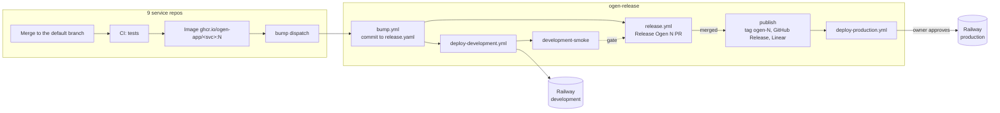

# How Ogen deploys

This directory explains how a change reaches **development** and how a release reaches
**production**, with the steps, who does them, and what happens in between.

| Page | Read it when |
| --- | --- |
| [development.md](development.md) | You merged something and want to know when it's on dev, or a dev deploy failed |
| [production.md](production.md) | You're releasing **Ogen N**, rolling production back, or shipping a hotfix |

[`RELEASING.md`](../RELEASING.md) is the one-page checklist for a release; these pages explain it.

## The idea in one paragraph

Every service builds **one image per green merge**, tagged with a build number. The images are
never rebuilt. `release.yaml` in this repo pins which build of every service runs together. A bump
to `release.yaml` deploys **development**. A release, **Ogen N**, freezes `release.yaml` under the
tag `ogen-N` and deploys exactly those images to **production**, after an owner approves.
Development is also the staging environment.

## The whole path

## Words used here

| Term | Meaning |
| --- | --- |
| **Build number** | The commit count on a service's default branch when its image was built. It only grows. `ghcr.io/ogen-app/ogen:1552` is build 1552 of the api. |
| **`release.yaml`** | The product lock file: one entry per service with its image, build and Railway ids, in deploy order. |
| **Bump** | A bot commit to `release.yaml`, `fix(deps): <service> <old> → <new>`, made when a service publishes a newer build. |
| **Ogen N** | A release: one number for the whole product (1, 2, 3, …), tagged `ogen-N`. `VERSION` holds the last released N. |
| **Release PR** | The PR "Release Ogen N", kept up to date from `main`, with the release notes. Merging it releases. |
| **`development-smoke`** | The commit status the dev deploy reports. The Release PR can only merge while it's green. |
| **`ogen-release-bot`** | The GitHub App that pushes bumps and tags. It's the only identity that may push to `main` directly. |

## The services

`release.yaml` lists them in deploy order. Each deploy goes through them one at a time, top to
bottom, and stops at the first failure.

| Entry | Repo | Image | Railway services |
| --- | --- | --- | --- |
| `pdf-service`, `document-service`, `image-service`, `audio-service`, `video-service` | same name | `ghcr.io/ogen-app/<name>` | one each |
| `river-service` | `river-service` | `ghcr.io/ogen-app/river-service` | two: `river-service` (light queues), then `river-service-heavy` |
| `api` | `ogen` | `ghcr.io/ogen-app/ogen` | one |
| `harbor` | `harbor` | `ghcr.io/ogen-app/harbor` | one |
| `ui` | `ui` (default branch `develop`) | `ghcr.io/ogen-app/ui` | one |

`getogen.com`, the databases and River UI are not part of a release.

## Principles

- **Build once.** Production runs the same image development tested, identified by its build
  number. Nothing is rebuilt for production.
- **Railway is the truth.** A deploy reads what each Railway service actually runs. It skips a
  service only when its latest deployment is healthy and runs the pinned image; it redeploys one
  whose image differs from `release.yaml` or whose latest deployment is unhealthy. A missed deploy
  or a manual rollback in Railway is caught on the next run.
- **Nothing reaches production by itself.** Every production change needs an owner: a release (a
  merged Release PR, then an approved deploy), a rollback (an approved run from an older release
  tag), or, in an emergency, Railway's own per-service rollback. See
  [production.md](production.md).
- **The logs are public.** This repo is public. No step prints a secret, a token, or a Railway id
  beyond those already in `release.yaml`.
