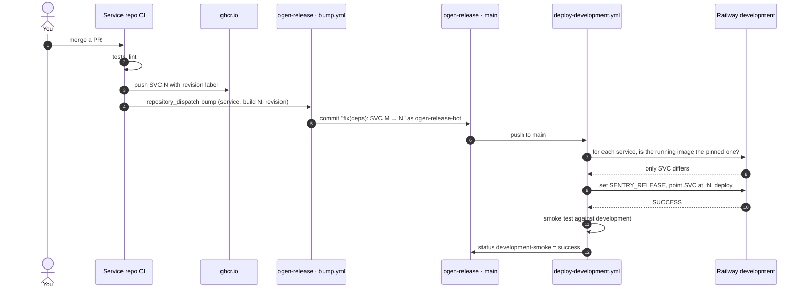
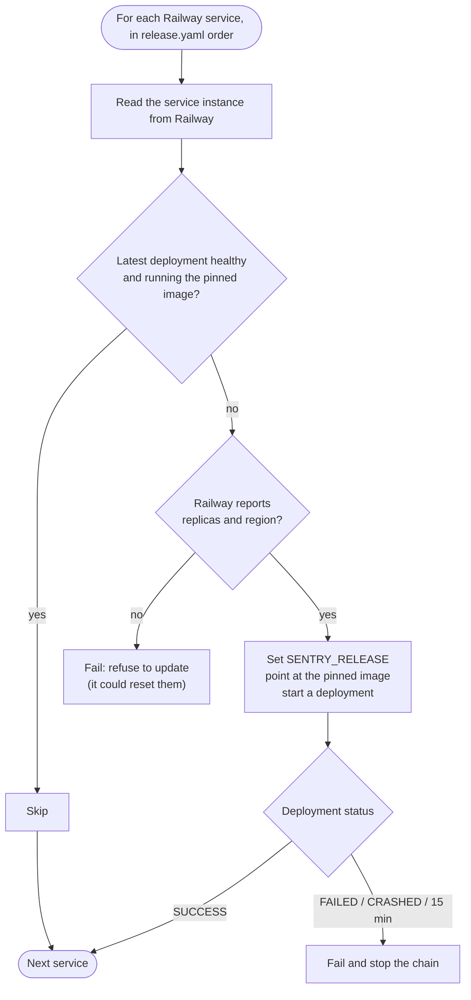

# Deploying development

Development deploys **by itself**: merging to a service's default branch is all you do. This page
explains what happens next, how to follow it, and what to do when it stops.

Development is also staging. It runs whatever `release.yaml` on `main` pins, and the next release
ships exactly that.

## What happens after a merge

### Step by step

1. **Merge** a PR to the service's default branch: `main`, or `develop` for ui.
2. **Service CI** runs the tests. If they fail, nothing else happens: no image, no bump.
3. **The image is published** as `ghcr.io/ogen-app/<service>:N`, where N is the commit count of
   the default branch. It carries the label `org.opencontainers.image.revision` = the commit SHA.
4. **The bump is sent.** CI mints a token from `ogen-release-bot` and sends a `bump` dispatch with
   `{service, build: N, revision}` to this repo.
5. **`bump.yml`** runs `cmd/bump`, which sets that service's `build` in `release.yaml` and commits
   `fix(deps): <service> <old> → <new>` straight to `main` as `ogen-release-bot`. It does nothing
   when:
   - the build is at or below the pinned one (a late or replayed dispatch), or
   - the service isn't listed in `release.yaml` yet.

   Bumps never cancel each other: they queue, and a push rejected because `main` moved is retried
   from the new `main` up to 5 times.
6. **`deploy-development.yml`** starts on the push to `main` and runs `cmd/deploy --env development`.
   It first checks the Railway token belongs to development, then goes through `release.yaml` top to
   bottom. For each Railway service:
   - if its latest deployment is healthy and runs the pinned image, it's **skipped**;
   - otherwise it sets `SENTRY_RELEASE=<service>@<build>`, points the service at the pinned image
     (keeping its replicas and region), starts a deployment and waits for `SUCCESS`, polling every
     5 seconds, for up to 15 minutes per service.

   The first `FAILED`, `CRASHED` or timeout stops the run; later services aren't touched.
7. **The smoke test** (`cmd/smoke`) runs against the development API with a dedicated smoke account:
   health, sign in, list campaigns, open the event stream, upload and delete a tiny image, sign out.
8. **`development-smoke`** is set on the `main` commit: `success`, or `failure` if the deploy or
   the smoke test failed. The Release PR's gate reads it ([production.md](production.md)).

Expected timing: the service's own CI dominates (about 11 minutes for ogen). From the image to a
deployed, smoke-tested dev usually takes 1–2 minutes.

### Deploy decisions

## How to follow a deploy

| Where | What you see |
| --- | --- |
| Service repo → Actions → CI | The image push and "Dispatch bump to ogen-release" |
| ogen-release → commits on `main` | The bump commit `fix(deps): …` by `ogen-release-bot[bot]` |
| ogen-release → Actions → **Deploy development** | One line per service: `… is running; nothing to do`, or `… → …:N`, `deployment SUCCESS`, `deployed`; then the smoke checks |
| ogen-release → the bump commit → status | `development-smoke`: green, red or pending |
| Railway → development → the service | The new deployment, its image `ghcr.io/ogen-app/<svc>:N`, its logs |

## When something goes wrong

| Symptom | Likely cause | What to do |
| --- | --- | --- |
| No bump commit after a green merge | The service's dispatch step was **skipped**: the release App token couldn't be minted | Check the org variable `RELEASE_APP_CLIENT_ID` and secret `RELEASE_APP_PRIVATE_KEY` are shared with the repo. Note the token step shows green even when it fails; look for a skipped dispatch |
| Bump run says `nothing to do` | The build isn't newer than the pin, or the service isn't in `release.yaml` | Expected for a replay. For a new service, add it to `release.yaml` (below) |
| Deploy fails: `the Railway token is scoped to …` | `RAILWAY_TOKEN_DEVELOPMENT` belongs to another environment | Replace it with a development-scoped project token |
| Deploy fails: `no replicas or region` | Railway reported no multi-region config for the service | Open the service in Railway and set its region and replicas, then re-run |
| Deploy fails: `deployment ended FAILED` | Railway couldn't start the image, often a failed healthcheck | Read the deployment's logs in Railway. A healthcheck needs the app to listen on `PORT` (harbor needs `PORT=9002`) |
| Deploy fails: `deployment ended CRASHED` | The new build crashes on start | Read the logs; fix forward with a new merge, or pin the previous build (below) |
| Smoke test fails | The deploy worked but the API misbehaves, or the smoke account's credentials are wrong | The failing check is named in the log. The smoke account is `SMOKE_EMAIL` / `SMOKE_PASSWORD` |
| Deploy fails: `deployment not done after 15m0s` | The deployment took longer than the per-service timeout | See "A timeout is not a failure" below |
| `development-smoke` is `error` ("Cancelled") | The deploy run was cancelled | Re-run Deploy development; waiting won't change it |
| `development-smoke` stays pending | The deploy run is still going, or it stopped before reporting | Wait for the run; if it's gone, re-run Deploy development |

When Railway marks a deployment `FAILED` or `CRASHED`, the previous deployment of that service keeps
serving: Railway only switches once the new one is healthy.

**A timeout is not a failure.** When a deployment isn't done after 15 minutes, the tool stops
waiting and fails the run, but the Railway deployment carries on. It may still become healthy and
go live after the run has reported failure. Open the service in Railway: if the new deployment is
live and healthy, re-run Deploy development to check the rest and report `development-smoke`; if it
failed, treat it like any failed deployment.

## Things you can do by hand

### Re-run the dev deploy

Actions → **Deploy development** → **Run workflow** on `main`. It deploys whatever differs between
Railway and `release.yaml`, so it's safe to run any time. Useful after fixing a Railway setting.

### Pin a service to another build (or roll one back on dev)

`release.yaml` is changed by people through a **PR**; only the bot pushes to `main` directly.

1. Branch from `main`, change the service's `build` to the build you want. The image must exist in
   GHCR.
2. Open a PR. CodeRabbit flags a lowered build without a reason in the description.
3. Merge it. Deploy development switches that service.

The next bump for that service moves it forward again, so a rollback on dev lasts until the next
merge there.

### Add a new service

1. In the service repo's CI, publish `ghcr.io/ogen-app/<service>:N` and send the `bump` dispatch,
   like the other services (copy the job from any of them).
2. Make the GHCR package public.
3. In Railway development: disconnect the service's repo source (Settings → Source → Disconnect),
   and set a healthcheck path if it serves HTTP.
4. Add an entry to `release.yaml` in the right place of the deploy order: `image`, `build` (the
   newest image, so dev isn't rolled back), `repo`, `railwayServiceId` (or `railwayServiceIds` for
   one image run as several Railway services).
5. Merge. Deploy development switches it to the image.

Until step 4, the service's bumps are logged as "not in release.yaml" and do nothing.

## Settings this relies on

| Where | Name | What |
| --- | --- | --- |
| ogen-release repo secret | `RAILWAY_TOKEN_DEVELOPMENT` | Railway project token scoped to development |
| ogen-release repo secrets | `SMOKE_EMAIL`, `SMOKE_PASSWORD` | The development smoke account |
| ogen-release repo secret | `SMOKE_DEVICE_COOKIE` | Optional: the smoke account's device cookie, so sign-ins don't send "new device" emails |
| ogen-release repo variable | `DEVELOPMENT_BASE_URL` | The development API origin |
| org variable + secret | `RELEASE_APP_CLIENT_ID`, `RELEASE_APP_PRIVATE_KEY` | The `ogen-release-bot` App, shared with every service repo |
| ogen-release `main` ruleset | — | PRs for people; only `ogen-release-bot` pushes directly |
| Railway development | each service | Image source, no repo source, so Railway builds nothing |
