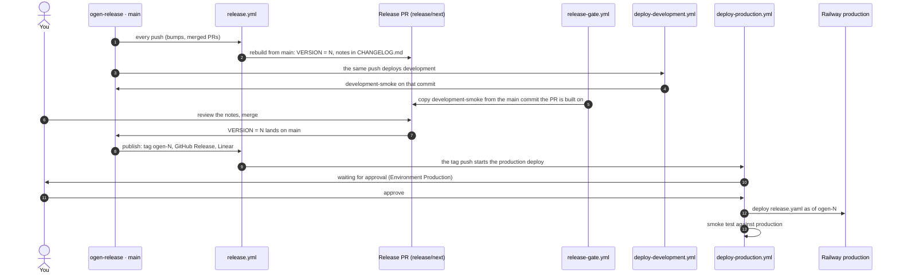
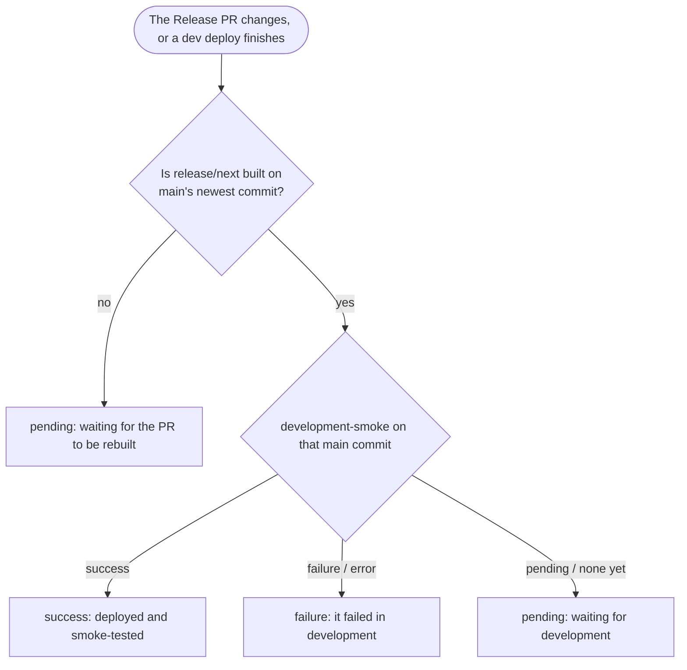
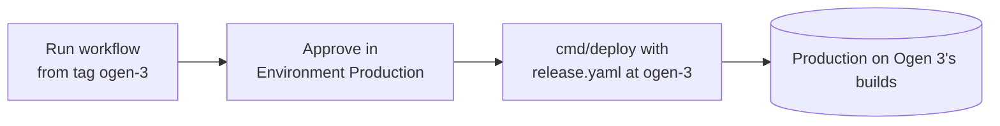

# Deploying production

Production changes only through a **release**: Ogen 1, Ogen 2, … Each release pins the build of
every service as it ran on development, and production gets exactly those images, after an owner
approves.

There are three things you do by hand: **review** the Release PR, **merge** it, and **approve**
the deploy. Everything else is automatic.

## The release, end to end

### Step by step

**1. Changes accumulate on `main`.**
Every bump and every merged PR runs `release.yml`. Its `pr` job compares `release.yaml` with the one
the last release shipped (`ogen-<N-1>`) and, if any build changed, rebuilds the branch
`release/next` from `main`:

- `VERSION` set to the next number N;
- that release's section prepended to `CHANGELOG.md`.

It then opens or updates **one** PR, "Release Ogen N", as `ogen-release-bot`. If nothing changed
since the last release, it closes the PR.

**2. Review the Release PR.** Its description is the release notes:

- **Features**, **Improvements**, **Fixes**: the Linear issues (labels Feature, Improvement, Bug)
  whose `CON-NN` ids start the commit subjects between each service's old and new build, and the
  services they touched;
- **Other**: issues with none of those labels, ids Linear doesn't know, and commits without a CON id;
- **Builds**: the table, e.g. `api 1552 → 1560`, new services, removed ones.

The first release, Ogen 1, has no earlier release to compare against: its notes are the build table
with "First release."

**3. Wait for the gate.** The Release PR has the required check **`development-smoke`**, which
`release-gate.yml` sets on it:

So the PR can merge only when development has deployed and smoke-tested **exactly** the
`release.yaml` the release will ship. The ruleset also requires the branch to be up to date with
`main`; the bot keeps it so.

Other PRs to `main` get `development-smoke: success` straight away ("Deploys to development after
merge"), since they're checked on development once merged.

**4. Merge it.** Any merge method works. On that push, `release.yml`'s `publish` job sees `VERSION`
changed and:

1. tags the merge commit `ogen-N` and pushes the tag as `ogen-release-bot`;
2. creates the GitHub Release **"Ogen N"** with the same notes;
3. in Linear, adds the label **`Ogen N`** to each shipped issue and comments "Shipped in Ogen N"
   with a link to the release. Issues already labelled are skipped, so a re-run is safe.

Then the `pr` job runs: with nothing new since `ogen-N`, there's no Release PR until the next bump.

**5. Approve the deploy.** The tag push starts **Deploy production**. It waits in the GitHub
Environment **Production** until a required reviewer approves (Actions → the run → Review
deployments → Approve).

**6. The deploy runs.** After approval it:

1. checks the run started from a release tag (`ogen-N`), before checking anything out;
2. checks out the tag and runs `cmd/deploy --env production` with **`release.yaml` as of the
   tag**, using the production-scoped Railway token: each service whose running image differs is
   updated and must reach `SUCCESS` before the next one starts, and the first failure stops it;
3. runs the smoke test against production with the production smoke account;
4. moves the `deployed/production` tag, an audit marker.

**7. Check it.** The run is green, the log shows `deployed` for the services that changed and
`nothing to do` for the rest, and all smoke checks pass.

Typical time from merging the Release PR to production: about 3 minutes, plus however long the
approval takes.

## Rolling back

To put the whole product back on an earlier release:

1. Actions → **Deploy production** → **Run workflow**.
2. In **Use workflow from**, pick the release tag to go back to, e.g. `ogen-3`, not a branch.
3. Approve it.

Every service whose running image differs from Ogen 3's `release.yaml` goes back to the build
Ogen 3 pinned. A run started from a branch is refused: the Environment only accepts `ogen-*` tags,
and the workflow checks the ref itself.

A rollback changes neither `main` nor the Release PR, so the next release carries everything forward
again. Revert or fix whatever caused the rollback before merging the next Release PR.

Rollback is safe because schema migrations are backward-compatible (expand → migrate → contract): an
older api build still runs on the newer schema.

For a single service in a hurry, Railway's own **Rollback** on that service's deployment is
quicker. The next production deploy brings it back to its pinned build.

## Hotfixes

There are no patch versions: a hotfix is simply the next release.

1. Fix it on the service's default branch. Its build is bumped and deployed to development as usual.
2. The Release PR now includes the fix.
3. Merge it and approve the deploy.

If `main` holds other unreleased bumps you don't want in production yet, open a PR against `main`
that sets those services back to their released builds in `release.yaml`, so the next release moves
only the fixed service. Development deploys that combination and the gate checks it before you
release.

## When something goes wrong

| Symptom | Likely cause | What to do |
| --- | --- | --- |
| No Release PR after a bump | Nothing changed since the last release, or the Release run failed | Actions → Release. If it says `tag ogen-N doesn't exist`, the last release wasn't published: re-run that merge's Release run |
| Release PR gate stays **pending** | Development hasn't finished deploying the latest `main` commit, or the PR is being rebuilt | Wait for Deploy development; the gate refreshes after it |
| Release PR gate is **red** | That `main` commit failed in development | Fix development first: [development.md](development.md) |
| Release PR says "out of date" | A bump landed after it was built | Nothing: the bot rebuilds it on that push |
| Publish failed after tagging | GitHub or Linear was unavailable | Re-run the failed Release run; each step skips what's already done |
| Deploy production never asks for approval | The run didn't start from a tag, or the Environment's tag rule doesn't match | It must be a tag `ogen-N`; the Environment allows `ogen-*` |
| Deploy fails: `the Railway token is scoped to …` | `RAILWAY_TOKEN_PRODUCTION` is a token for another environment | Replace it with a production-scoped project token |
| Deploy fails on a service | Its new build doesn't start in production | Read that deployment's logs in Railway. Production keeps the previous deployment of that service; roll back if needed |
| Smoke test fails | Production misbehaves, or the production smoke account's credentials are wrong | The log names the failing check; the account is the Environment's `SMOKE_EMAIL` / `SMOKE_PASSWORD` |

## Settings this relies on

| Where | Name | What |
| --- | --- | --- |
| GitHub Environment **Production** | Required reviewers | The owners who approve production deploys |
| | Deployment branches and tags | Selected: tag pattern `ogen-*` |
| | Secret `RAILWAY_TOKEN_PRODUCTION` | Railway project token scoped to production |
| | Secrets `SMOKE_EMAIL`, `SMOKE_PASSWORD` | The production smoke account. They replace the repo's development ones of the same name inside the production job |
| | Secret `SMOKE_DEVICE_COOKIE` | Optional: its device cookie, so sign-ins don't send "new device" emails |
| ogen-release repo variable | `PRODUCTION_BASE_URL` | The production API origin |
| ogen-release repo secret | `LINEAR_API_KEY` | Release notes, and labelling and commenting on shipped issues |
| ogen-release `main` ruleset | Required check | `development-smoke`, with "Require branches to be up to date" |
| `ogen-release-bot` App | Permissions | Contents and Pull requests: read and write, installed on `ogen-release` |
